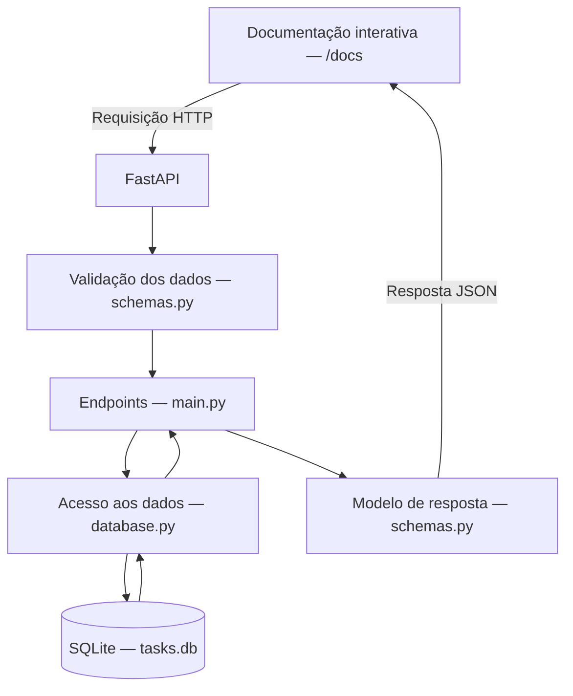

# ToDo List

API local de lista de tarefas desenvolvida na especialização da UFG, com Python,
FastAPI e SQLite. Permite criar, consultar, editar, concluir, filtrar e excluir
tarefas, mantendo os dados entre execuções.

## Versão de entrega

O escopo da primeira versão está concluído e identificado pela
[tag v1.0.0](https://github.com/hugopin/ToDo_List/tree/v1.0.0).
A entrega inclui persistência em SQLite, validação de entradas, tratamento de
tarefas inexistentes, dez casos de teste automatizados e licença MIT.

A documentação interativa em `/docs` é a interface prevista para esta versão.
Uma interface própria e as demais melhorias ficam para uma versão futura.

Os atalhos de automação descritos abaixo foram acrescentados após a tag
`v1.0.0` e estão disponíveis na branch `main`.

## Instalação

As instruções abaixo usam Windows com PowerShell. O projeto foi desenvolvido
e testado com Python 3.14.7. É necessário ter Python e Git instalados.

1. Clone o repositório e entre na pasta:

   ```powershell
   git clone https://github.com/hugopin/ToDo_List.git
   cd ToDo_List
   ```

2. Crie e ative o ambiente virtual:

   ```powershell
   py -m venv .venv
   .\.venv\Scripts\Activate.ps1
   ```

3. Instale as dependências com o ambiente virtual ativo:

   ```powershell
   python -m pip install -r requirements.txt
   ```

O SQLite é acessado pelo módulo `sqlite3`, incluído no Python; não é necessário
instalar um servidor de banco de dados.

## Execução

Na raiz do projeto, com o ambiente virtual ativo, inicie o servidor:

```powershell
python -m uvicorn app.main:app --reload
```

Após a mensagem `Application startup complete`, acesse a
[documentação interativa](http://127.0.0.1:8000/docs) no navegador para experimentar
as operações. O servidor atende localmente em `http://127.0.0.1:8000`.

O arquivo `tasks.db` e sua tabela são criados automaticamente na primeira
inicialização. As tarefas permanecem salvas após reiniciar o servidor, desde que
esse arquivo seja mantido.

Para encerrar o servidor, pressione `Ctrl+C` no terminal. Em uma nova sessão,
ative novamente a `.venv` antes de executar o comando do servidor.

### Execução fora do VS Code

O VS Code não é necessário para executar a aplicação. Abra o PowerShell,
entre na pasta do projeto e use diretamente o Python do ambiente virtual:

```powershell
cd "C:\caminho\para\ToDo_List"
.\.venv\Scripts\python.exe -m uvicorn app.main:app
```

Substitua o caminho pela localização do seu projeto. Essa forma dispensa ativar
a `.venv`. Mantenha o terminal aberto e acesse `http://127.0.0.1:8000/docs`.
Encerre com `Ctrl+C`. Se já houver um servidor na porta 8000, encerre-o antes
de iniciar outro. A opção `--reload` é útil durante o desenvolvimento e foi
omitida neste comando de execução.

## Automação de tarefas

Após criar a `.venv`, é possível usar os atalhos abaixo sem ativá-la.
O script PowerShell é a opção para Windows sem instalar `make`.

Se a política do PowerShell bloquear arquivos `.ps1`, use `manage.cmd` com a
mesma ação, por exemplo: `.\manage.cmd test`. Essa alternativa não exige
alterar a política de execução. Também estão disponíveis `help`, `install`,
`run` e `check`; o comando `run` do `.cmd` usa a porta 8000.

| Ação | PowerShell | Makefile (com GNU Make instalado) |
|---|---|---|
| Mostrar ajuda | `.\manage.ps1 help` | `make help` |
| Instalar dependências | `.\manage.ps1 install` | `make install` |
| Iniciar a API local | `.\manage.ps1 run` | `make run` |
| Executar os dez testes | `.\manage.ps1 test` | `make test` |
| Conferir dependências | `.\manage.ps1 check` | `make check` |

Execute os comandos na raiz do projeto. O `manage.ps1` também pode ser chamado
pelo caminho completo a partir de outra pasta. Ele retorna um código de erro
se o comando Python falhar e não altera a política de execução do PowerShell.

Para usar uma porta diferente: `.\manage.ps1 run -Port 8001` ou
`make run PORT=8001`. O endereço padrão é `http://127.0.0.1:8000/docs`.
Mantenha o terminal aberto durante a execução e encerre com `Ctrl+C`.

O Makefile seleciona o Python da `.venv` conforme o sistema operacional;
os caminhos para outros sistemas ainda não foram validados. Não há alvo de
formatação, pois o projeto não adotou um formatador automático nesta versão.
Os comandos manuais das seções anteriores continuam disponíveis.

Na validação local, `manage.cmd help`, `manage.cmd check` e `manage.cmd test`
foram executados: as dependências estavam consistentes e os dez testes passaram.
O GNU Make não estava instalado e a política do ambiente bloqueou o `.ps1`;
portanto, esses dois caminhos não foram validados por execução.

## Endpoints e exemplos de uso

Com o servidor iniciado, abra `/docs`, expanda uma operação, clique em
**Try it out**, preencha os dados e clique em **Execute**.

| Método | Endereço | Operação | Código de sucesso |
|---|---|---|---|
| POST | `/tasks` | Criar uma tarefa pendente | 201 |
| GET | `/tasks` | Listar todas as tarefas | 200 |
| GET | `/tasks?completed=false` | Listar tarefas pendentes | 200 |
| GET | `/tasks?completed=true` | Listar tarefas concluídas | 200 |
| GET | `/tasks/{id}` | Consultar uma tarefa | 200 |
| PATCH | `/tasks/{id}` | Editar título, descrição ou conclusão | 200 |
| DELETE | `/tasks/{id}` | Excluir uma tarefa | 204 |

### Criar uma tarefa

Em `POST /tasks`, envie:

```json
{
  "title": "Estudar FastAPI",
  "description": "Acompanhar o miniprojeto da UFG"
}
```

Resposta de exemplo, com código 201:

```json
{
  "id": 1,
  "title": "Estudar FastAPI",
  "description": "Acompanhar o miniprojeto da UFG",
  "completed": false
}
```

O identificador é gerado automaticamente e pode variar. A descrição pode ser
omitida; nesse caso, será `null`. Títulos vazios ou contendo apenas espaços
são rejeitados com código 422.

### Listar e consultar

Em `GET /tasks`, deixe `completed` sem preencher para listar todas as tarefas,
ou selecione `false` para pendentes e `true` para concluídas. A resposta é uma
lista; quando não há resultados, retorna `[]` com código 200.

Em `GET /tasks/{id}`, informe o identificador recebido na criação. A resposta
contém uma única tarefa.

### Editar e alterar a conclusão

Em `PATCH /tasks/{id}`, informe o identificador e envie apenas os campos que
deseja alterar. Por exemplo, para editar o título:

```json
{
  "title": "Revisar FastAPI"
}
```

Para marcar como concluída:

```json
{
  "completed": true
}
```

Use `false` para voltar a pendente. Os campos omitidos mantêm seus valores.
Para remover a descrição, envie `{"description": null}`. Uma edição válida
retorna a tarefa atualizada com código 200; título vazio ou valor nulo para
`title` ou `completed` retorna 422.

### Excluir e consultar erros

Em `DELETE /tasks/{id}`, informe o identificador da tarefa que deseja remover.
Uma exclusão realizada retorna 204, sem corpo na resposta.

Consultar, editar ou excluir um identificador inexistente retorna 404:

```json
{
  "detail": "Tarefa não encontrada."
}
```

Campos desconhecidos no corpo de criação ou edição são rejeitados com código
422. Por exemplo, `titel` em vez de `title` causa um erro de validação e nenhuma
tarefa é criada ou alterada. Na criação, envie somente `title` e `description`;
o identificador e a conclusão inicial são definidos pela aplicação.

## Testes

Na raiz do projeto, com a `.venv` ativa e as dependências instaladas, execute:

```powershell
python -m pytest tests/test_tasks.py -v
```

O resultado esperado é `10 passed`. A opção `-v` mostra o nome e o resultado de
cada caso. Não é necessário iniciar o Uvicorn: os testes usam o `TestClient`
do FastAPI para enviar requisições diretamente à aplicação. O cliente utiliza
HTTPX2, registrado no `requirements.txt`. A migração do HTTPX para HTTPX2
resolveu o aviso de descontinuação, e os dez casos passaram após a mudança.

Os dez casos verificam:

- Criação com identificador gerado e situação inicial pendente.
- Rejeição de título vazio.
- Rejeição de título contendo apenas espaços.
- Consulta de tarefa inexistente com retorno 404.
- Edição parcial preservando os campos omitidos.
- Exclusão com retorno 204 e erros 404 nas tentativas posteriores.
- Listagem com filtros de pendentes e concluídas.
- Persistência entre encerramento e nova inicialização do ciclo de vida da aplicação.
- Rejeição de campos desconhecidos na criação, sem salvar uma nova tarefa.
- Rejeição de campos desconhecidos na edição, preservando a tarefa existente.

Cada caso utiliza um banco SQLite em uma pasta temporária, separado do
`tasks.db` local. No teste de persistência, as duas inicializações usam o mesmo
banco temporário. A fixture `temporary_database` centraliza a configuração do
caminho e mantém um banco separado por caso. Os testes ficam em `tests/test_tasks.py`.

### Validação em um ambiente virtual novo

A instalação foi conferida em um ambiente virtual separado da `.venv` de
desenvolvimento, criado na pasta temporária do Windows com Python 3.14.7.
As dependências foram instaladas exclusivamente pelo `requirements.txt`.
O `pip check` não encontrou inconsistências, e os dez casos de teste passaram
nesse ambiente, sem avisos na saída apresentada.

Essa verificação foi realizada no mesmo computador, com os arquivos atuais do
projeto. Ela confirma a preparação das dependências e a execução da suíte em
um ambiente virtual novo; não comprova instalação em outros computadores,
outros sistemas operacionais ou a partir de uma clonagem independente.

## Arquitetura

A aplicação é uma API local em Python, com FastAPI e SQLite. As operações
podem ser experimentadas pela documentação interativa em `/docs`.



- `app/main.py`: inicializa o banco ao iniciar a aplicação e define os endpoints.
- `app/schemas.py`: define os modelos de entrada e saída e valida os dados recebidos.
- `app/database.py`: abre conexões e executa as operações SQL.
- `tasks.db`: guarda as tarefas entre execuções e fica fora do controle de versão.

O diagrama representa o fluxo de uma requisição válida. Dados inválidos recebem
uma resposta de erro antes de executar a operação no banco.

## Uso de inteligência artificial no desenvolvimento

Este miniprojeto foi desenvolvido com apoio do Codex, por meio de uma interação
conversacional integrada ao ambiente de desenvolvimento. O trabalho seguiu a
proposta da apostila M4 da especialização da UFG: utilizar IA generativa durante
o desenvolvimento, compreender as sugestões e validar os resultados.

A orientação dada ao assistente desde o início foi explicar cada etapa antes
de propor alterações, avançar uma etapa por vez e aguardar meu retorno.
Essa restrição permitiu acompanhar as decisões e experimentar cada operação
antes de continuar a implementação.

### Participação da IA e do desenvolvedor

| Etapa | Apoio da IA | Minha participação |
|---|---|---|
| Escopo e planejamento | Análise da apostila, proposta do contrato HTTP e organização dos arquivos | Definição das funcionalidades, regras e limites da primeira versão; aprovação das propostas |
| Implementação | Escrita incremental dos modelos Pydantic, operações SQLite e endpoints FastAPI, com explicações | Acompanhamento das etapas e experimentação das operações pela documentação interativa |
| Diagnóstico do ambiente | Interpretação de mensagens de erro e consulta à documentação oficial | Execução dos comandos, consulta aos eventos do Windows e decisão sobre a configuração do computador |
| Testes | Criação de casos automatizados e verificação com bancos temporários | Execução da suíte no meu terminal e compartilhamento dos resultados antes de avançar |
| Documentação e Git | Elaboração do diagrama Mermaid, instruções e sugestões de mensagens de commit | Execução de comandos Git, conferência dos arquivos preparados e publicação dos commits no GitHub |

### Decisões e aprendizados

- **Controlar o escopo:** a aplicação ficou limitada a uma API local de tarefas.
  Exemplos da apostila com frontend, PostgreSQL ou integração com modelos de IA
  não foram incorporados à primeira versão. O uso de IA ocorreu no processo de
  desenvolvimento; a API não faz chamadas a modelos de linguagem.
- **Descrever o comportamento antes de programar:** os endpoints, campos e
  códigos HTTP foram combinados antes da implementação, servindo de referência
  para os testes e para a documentação.
- **Distinguir omissão de ausência de valor:** na edição parcial, um campo
  omitido mantém o valor existente; `description: null` remove a descrição.
  Essa diferença foi explicada e a preservação de campos recebeu um teste.
- **Verificar além da resposta imediata:** a suíte consulta dados após alterações,
  confirma que títulos inválidos não são salvos e verifica persistência entre
  duas inicializações do ciclo de vida da aplicação.
- **Usar erros como material de estudo:** o bloqueio do componente compilado do
  Pydantic foi investigado com o traceback e os eventos de integridade do Windows.
  Uma reinstalação não resolveu; a importação funcionou após minha decisão de
  desativar o Smart App Control. Essa foi uma decisão específica do meu ambiente,
  não uma instrução de instalação do projeto.
- **Reconhecer limites das sugestões:** a alternativa de instalar WSL foi
  questionada por acrescentar complexidade ao primeiro projeto. O desenvolvimento
  continuou no Windows, mostrando a importância de avaliar as propostas da IA.
- **Entender o controle de versão:** salvar um arquivo, prepará-lo com `git add`,
  registrar um commit e enviá-lo com `git push` são etapas distintas. A atualização
  do README no GitHub tornou essa diferença visível durante o trabalho.

### Validação e limites do relato

As funcionalidades foram experimentadas em `/docs`, e os dez casos da suíte
automatizada passaram no ambiente local e em um ambiente virtual novo.
A IA também executou verificações em bancos temporários durante a implementação.
Esses resultados cobrem os cenários
descritos na seção de testes e não garantem ausência de falhas em todos os usos.

O acompanhamento humano incluiu a definição do escopo, a avaliação das propostas,
a execução dos comandos e a conferência dos resultados. Não houve medição formal
de tempo ou comparação com desenvolvimento sem IA; portanto, não são apresentados
percentuais ou estimativas de ganho de produtividade.

## Limitações e próximos passos

### Limitações da primeira versão

Esta versão tem finalidade didática e é executada localmente. Seu escopo é o
gerenciamento básico de tarefas, com persistência em SQLite.

- Não há login, autenticação, autorização ou separação de tarefas por usuário.
- Não há prioridades, prazos, notificações ou lembretes.
- A interação é feita pela documentação do FastAPI; não existe interface visual própria.
- A listagem permite filtrar por conclusão, mas não possui busca por texto ou paginação.
- Não foram realizados testes de carga, concorrência ou instalação em outros sistemas operacionais.
- Os dez casos automatizados cobrem os cenários documentados, mas não todas as
  combinações de entradas e operações. A persistência é verificada reiniciando o
  ciclo de vida da aplicação dentro do processo de testes.

### Possíveis evoluções

As sugestões abaixo são possibilidades para versões futuras, sem compromisso
de implementação nesta entrega:

- Ampliar os testes para atualização e exclusão de identificadores inexistentes,
  remoção da descrição, retorno de concluída para pendente e filtros sem resultados.
- Automatizar a execução dos testes no GitHub Actions.
- Verificar a instalação a partir de uma clonagem independente e em outros ambientes.
- Conforme novas necessidades, avaliar busca, paginação e uma interface própria.

Recursos como múltiplos usuários, prioridades, prazos e notificações exigiriam
novas regras e uma revisão do escopo antes de serem incorporados.

## Licença

Este projeto é disponibilizado sob a [licença MIT](LICENSE).
Copyright (c) 2026 hugopin. As dependências e a apostila do curso mantêm suas
próprias licenças e condições de uso.
