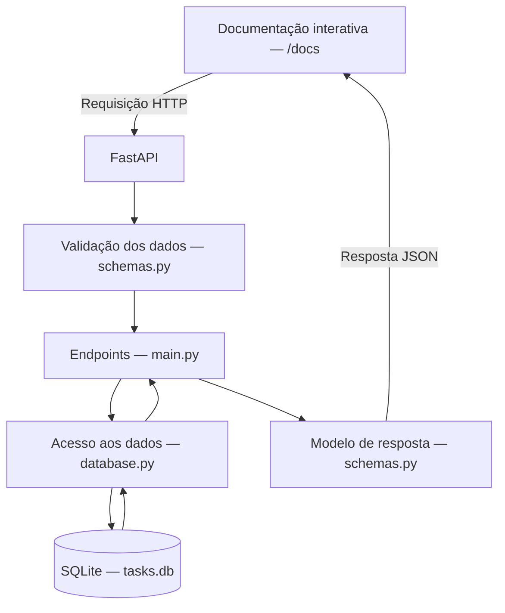

# ToDo List

Projeto de lista de tarefas desenvolvido na especialização da UFG.

## Arquitetura

A aplicação é uma API local em Python, com FastAPI e SQLite. As operações
podem ser experimentadas pela documentação interativa em `/docs`.

- `app/main.py`: inicializa o banco ao iniciar a aplicação e define os endpoints.
- `app/schemas.py`: define os modelos de entrada e saída e valida os dados recebidos.
- `app/database.py`: abre conexões e executa as operações SQL.
- `tasks.db`: guarda as tarefas entre execuções e fica fora do controle de versão.

O diagrama representa o fluxo de uma requisição válida. Dados inválidos recebem
uma resposta de erro antes de executar a operação no banco.
