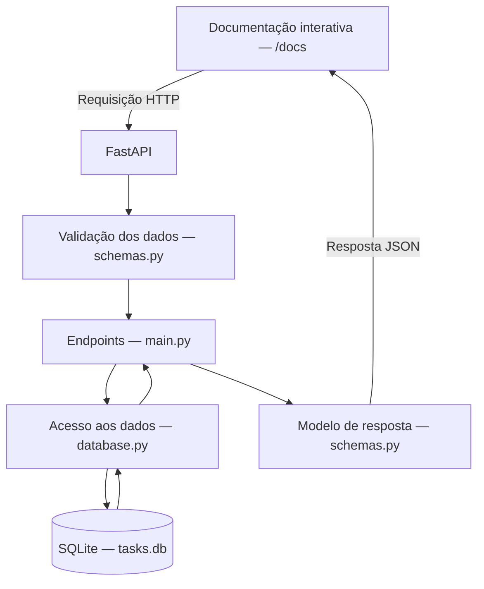

# ToDo List

Projeto de lista de tarefas desenvolvido na especialização da UFG.

## Instalação

As instruções abaixo usam Windows com PowerShell. O projeto foi desenvolvido
e testado com Python 3.14.7. É necessário ter Python e Git instalados.

1. Clone o repositório e entre na pasta:

   ```powershell
   git clone https://github.com/hugopin/ToDo_List.git
   cd ToDo_List
   ```

2. Crie e ative o ambiente virtual:

   ```powershell
   py -m venv .venv
   .\.venv\Scripts\Activate.ps1
   ```

3. Instale as dependências com o ambiente virtual ativo:

   ```powershell
   python -m pip install -r requirements.txt
   ```

O SQLite é acessado pelo módulo `sqlite3`, incluído no Python; não é necessário
instalar um servidor de banco de dados.

## Execução

Na raiz do projeto, com o ambiente virtual ativo, inicie o servidor:

```powershell
python -m uvicorn app.main:app --reload
```

Após a mensagem `Application startup complete`, acesse a
[documentação interativa](http://127.0.0.1:8000/docs) no navegador para experimentar
as operações. O servidor atende localmente em `http://127.0.0.1:8000`.

O arquivo `tasks.db` e sua tabela são criados automaticamente na primeira
inicialização. As tarefas permanecem salvas após reiniciar o servidor, desde que
esse arquivo seja mantido.

Para encerrar o servidor, pressione `Ctrl+C` no terminal. Em uma nova sessão,
ative novamente a `.venv` antes de executar o comando do servidor.

## Testes

Na raiz do projeto, com a `.venv` ativa e as dependências instaladas, execute:

```powershell
python -m pytest tests/test_tasks.py -v
```

O resultado esperado é `8 passed`. A opção `-v` mostra o nome e o resultado de
cada caso. Não é necessário iniciar o Uvicorn: os testes usam o `TestClient`
do FastAPI para enviar requisições diretamente à aplicação.

Os oito casos verificam:

- Criação com identificador gerado e situação inicial pendente.
- Rejeição de título vazio.
- Rejeição de título contendo apenas espaços.
- Consulta de tarefa inexistente com retorno 404.
- Edição parcial preservando os campos omitidos.
- Exclusão com retorno 204 e erros 404 nas tentativas posteriores.
- Listagem com filtros de pendentes e concluídas.
- Persistência entre encerramento e nova inicialização do ciclo de vida da aplicação.

Cada caso utiliza um banco SQLite em uma pasta temporária, separado do
`tasks.db` local. No teste de persistência, as duas inicializações usam o mesmo
banco temporário. Os testes ficam em `tests/test_tasks.py`.

## Arquitetura

A aplicação é uma API local em Python, com FastAPI e SQLite. As operações
podem ser experimentadas pela documentação interativa em `/docs`.



- `app/main.py`: inicializa o banco ao iniciar a aplicação e define os endpoints.
- `app/schemas.py`: define os modelos de entrada e saída e valida os dados recebidos.
- `app/database.py`: abre conexões e executa as operações SQL.
- `tasks.db`: guarda as tarefas entre execuções e fica fora do controle de versão.

O diagrama representa o fluxo de uma requisição válida. Dados inválidos recebem
uma resposta de erro antes de executar a operação no banco.
